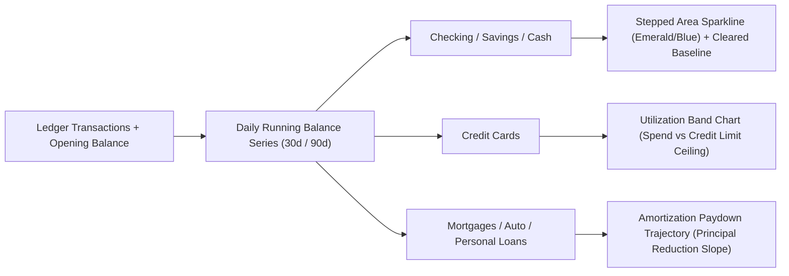

# Account Card Real-Time Charting & Telemetry Plan

## 1. Objective & Current State

While we have immediately replaced the static mock curves on [`AccountSparklineCardComponent`](file:///home/pete/projects/path-logic/app/src/app/components/dashboard/account-sparkline-card/account-sparkline-card.component.ts) with ledger-derived balance history points (and flat zero-balance baselines for `$0.00` accounts), upgrading the account card charts across the **Overview (`DashboardComponent`)** and **Accounts (`AccountsPageComponent`)** pages into a true financial telemetry visual requires aligning on:

1. **Charting Engine / Tool Selection**
2. **Chart Visual Style (Per Account Type)**
3. **Information Density & Interactivity Tiers**

---

## 2. Charting Tool Selection (Options Comparison)

> [!TIP]
> **Chart.js (`chart.js` v4.5 + `primeng/chart`) is already installed** in `package.json` and powers [`ProjectionChartComponent`](file:///home/pete/projects/path-logic/app/src/app/components/dashboard/projection-chart/projection-chart.component.ts). However, instantiating 8–16 separate `<canvas>` Chart.js instances inside repeating account cards has different trade-offs than a purpose-built SVG/Canvas micro-chart or lightweight time-series library.

| Option                                                                                                    | Footprint                                                              | Pros                                                                                                                                                                                                                                                         | Cons                                                                                                              | Recommendation                                                    |
| :-------------------------------------------------------------------------------------------------------- | :--------------------------------------------------------------------- | :----------------------------------------------------------------------------------------------------------------------------------------------------------------------------------------------------------------------------------------------------------- | :---------------------------------------------------------------------------------------------------------------- | :---------------------------------------------------------------- |
| **Option A (Recommended): Hybrid Chart.js (Hero) + High-Precision SVG Area/Step Micro-Chart (Sub-Cards)** | **0 KB added** (uses existing `chart.js` + native Angular SVG Signals) | • Interactive hover crosshair & date/balance tooltips on the **Hero Card** via `UIChart` (`Chart.js`) • Zero canvas memory overhead on sub-grid & Accounts page cards • Crisp vector rendering at any DPI and instant CSS dark/light theme transitions | • Requires a shared `AccountTelemetryService` to compute daily running-balance buckets once per ledger revision   | **Recommended**                                                   |
| **Option B: Chart.js (`primeng/chart`) Everywhere**                                                       | **0 KB added**                                                         | • Single charting API across Forecast Banner, Hero Card, and Sub-Cards • Built-in tooltips and animations                                                                                                                                                 | • Creating 10+ Chart.js `<canvas>` instances on a single page adds resize-observer and canvas allocation overhead | Good if hover tooltips are wanted on every small card             |
| **Option C: `uPlot` Time-Series Canvas Engine**                                                           | **~45 KB min**                                                         | • Bloomberg-grade financial time-series performance • Sub-millisecond rendering for 90-day / 365-day daily series                                                                                                                                         | • Requires adding a new npm dependency (`uplot`) and custom Angular wrapper                                       | Best if we want high-frequency interactive scrubbing on all cards |

---

## 3. Chart Style & Financial Semantics by Account Type

Different account classes have fundamentally different trajectories and should not all use a generic smooth spline:

1. **Depository Accounts (`Checking`, `Savings`, `Cash`)**:
    - **Style**: **Stepped Area Chart** (or low-tension monotone cubic curve) with a subtle gradient fill under the daily closing balance line.
    - **Why Stepped/Monotone**: Bank balances change in discrete daily steps when paychecks or bills clear; standard bezier splines (`tension: 0.4`) can overshoot and imply negative dips that never happened.
2. **Revolving Credit (`Credit Card`)**:
    - **Style**: **Balance Due + Credit Limit Reference Line** (when `creditCardDetails.creditLimit` is known).
    - **Color Semantics**: Amber/Rose when balance due increases (spending); Emerald when balance due drops (payment posted).
3. **Installment Liabilities (`Mortgage`, `Auto Loan`, `Personal Loan`)**:
    - **Style**: **Principal Paydown Slope** over a 12-month or 90-day window (since loans only move once per month and look flat on a 30-day window).
4. **Zero-Balance Accounts (`$0.00`)**:
    - **Style**: Muted dashed horizontal baseline (`$0.00`) with no artificial trend percentage pill.

---

## 4. Information Density Tiers

| Surface                                     | Time Window                             | Data Points & Overlays                                                                                                                                      | Interactivity                                                           |
| :------------------------------------------ | :-------------------------------------- | :---------------------------------------------------------------------------------------------------------------------------------------------------------- | :---------------------------------------------------------------------- |
| **1. Overview Hero Card (Full Width)**      | **30d / 90d Toggle**                    | • Daily closing balance area curve • 30-day High / Low / Net Delta (`+$1,240.00 / +8.4%`) • Upcoming scheduled bill markers (dots on future 14d tail) | Hover crosshair tooltip showing exact Date + Balance + Net Daily Change |
| **2. Overview Sub-Grid Cards (3-Up)**       | **30d Rolling** (or **180d** for Loans) | • Clean 30-point daily balance area + stroke • Single 30d net delta badge (`+$320` or `+2.1%`)                                                           | Static visual with click-through to Ledger                              |
| **3. Accounts Page Card (Expanded Drawer)** | **90d History + 30d Forecast**          | • Mini historical + projected cashflow strip inside the expanded account drawer alongside Cleared/Pending telemetry                                         | Hover tooltip with transaction count per week                           |

---

## 5. Proposed Implementation Phases

1. **Phase 1 — `AccountTelemetryService` (`@core` + Angular Service)**:
    - Compute deterministic daily closing balances (`Array<{ date: ISODateString; balance: Cents; txCount: number }>`) per account over 30d / 90d / 180d windows from `LedgerStore.transactions()` and `IAccount.openingBalance`.
2. **Phase 2 — Overview Hero Card Interactive Chart**:
    - Upgrade the full-width Hero card in [`AccountSparklineCardComponent`](file:///home/pete/projects/path-logic/app/src/app/components/dashboard/account-sparkline-card/account-sparkline-card.component.ts) to render a real interactive `30d / 90d` stepped area chart with hover tooltips, High/Low range callouts, and credit-utilization ceiling indicator.
3. **Phase 3 — Sub-Card & Accounts Drawer Micro-Charts**:
    - Render true 30-day (and 180-day for loans) monotone/stepped area charts with gradient fills and accurate 30-day dollar/percent delta badges.
