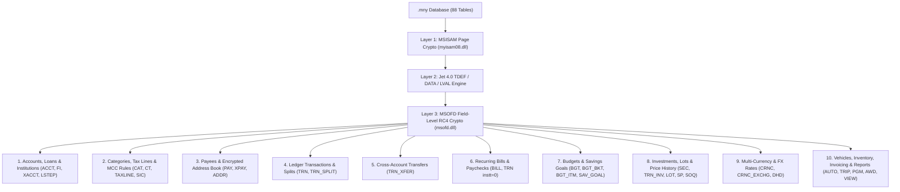
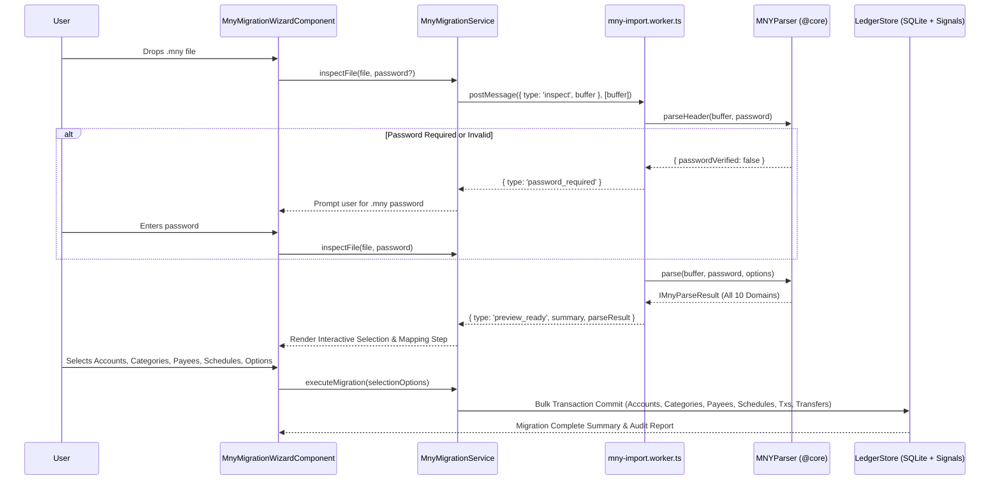

# Microsoft Money (`.mny`) Full Workspace Migration & Import System — Project Plan

## 1. Executive Summary & Mandatory Runtime UI Results

Every phase in this roadmap is architected around an **uncompromising Runtime UI Result** that is visually interactive and testable in the running application (`localhost:4200`) and Storybook (`localhost:6006`).

### Phase-by-Phase Runtime UI Results:

1. **Phase 1 Runtime UI Result**:
    - **In the Running App**: In **Settings → Data & Backup**, users click _"Migrate from Microsoft Money (.mny)"_ to open a sleek 4-step modal wizard. Dropping `sample.mny` displays file size (7.7 MB) and 88 tables. Users enter credentials, select from high-density tabs for **Accounts (23)**, **Categories (141)**, **Payees (165)**, and **Transactions (3,166)**, click _"Execute Migration"_, watch a 60fps streaming progress bar, view the penny-perfect audit card (\$0.00 discrepancy), and click _"Go to Accounts Overview"_ to see all 23 accounts and transactions live in the real ledger.
    - **In Storybook**: 5 interactive stories with `play` functions validating all states across Mobile (`390px`), Tablet (`768px`), and Desktop (`1280px+`) in Light and Dark themes.

2. **Phase 2 Runtime UI Result**:
    - **In the Running App**: The Accounts tab in the wizard displays mortgage/auto loan badges (`4.5% APR • 30-Yr Fixed`, monthly payment, term); the Payees tab features an expandable contact drawer revealing street address, city, state, zip, phone, and aliases. After migration, loan account header cards in the ledger render mortgage details, and the Payee directory displays full address books and alias variations.
    - **In Storybook**: Story states demonstrating loan badges, financial institution branding, and payee address book drawers.

3. **Phase 3 Runtime UI Result**:
    - **In the Running App**: The wizard lights up the **"Transfers (534)"** tab and **"Recurring (14)"** tab. In the live ledger, clicking any transfer transaction reveals a two-way jump link navigating directly to the opposing account's ledger. Navigating to the **Recurring Dashboard** (`/recurring`) shows all 14 active schedules, and the **90-Day Cashflow Projection Graph** immediately renders a forward-looking daily balance projection populated by the imported paychecks and bills.
    - **In Storybook**: Story states with interactive `play` steps for transfer reconciliation and recurring split schedule previews.

4. **Phase 4 Runtime UI Result**:
    - **In the Running App**: The wizard activates the **"Extended Archive"** tab with trade memo synthesis (`BUY 50 MSFT @ $28.50`). On the completion screen, a prominent **"Download Complete .mny Archive (.json)"** button triggers an instant client-side download of all 88 parsed tables in formatted JSON, while investment accounts display trade activity in the ledger.
    - **In Storybook**: Story states testing JSON archive export downloads and trade synthesis options.

---

### 1.1 Key Technical Decisions

1. **Pure TypeScript in a Web Worker (No WASM Required)**
    - **Benchmark**: Deserializing the 7.7 MB `sample.mny` database (1,881 pages, 88 tables, 3,166 `TRN` rows, 1,152 `TRN_SPLIT` rows, RC4 page crypto, and MSOFD field-level RC4 crypto) completes in **~28 ms** in V8 using `Uint8Array` and `DataView` ([MNYParser.spec.ts](file:///home/pete/projects/path-logic/app/src/app/core/parsers/MNYParser.spec.ts#L186-L287)).
    - **Why Web Worker over WASM**: Running `MNYParser` inside a dedicated Angular Web Worker (`mny-import.worker.ts`) using zero-copy `ArrayBuffer` transferables avoids WASM linear-memory marshaling overhead while keeping the main UI thread at a locked 60fps with real-time progress reporting.
2. **Full-State Workspace Migration + Selective Account Import**
    - Unlike `.qif` (which only carries a single account's transaction stream), a `.mny` file is a **complete relational database (88 tables)** encompassing the user's entire financial life.
    - The system will support both **Full Workspace Migration** (Accounts, Loans, Categories, Payees + Addresses, Recurring Schedules, Transactions, Splits, Transfers, and Extended `.mny` tables) and **Selective / Incremental Import** (importing or reconciling specific accounts/tables into an existing Path Logic workspace).
3. **Full Password & Master-Key Unwrapping Support**
    - Supports passwordless `.mny` files, **Direct Password** files (`SHA-1`/`MD5` of 40-byte uppercase UTF-16LE password), and **Money 2005+ / Money Plus Wrapped Master Key (`OFL\` / `ONL\`)** files (`myisam08.dll` `FUN_004305e7`), plus MSOFD field-level column decryption (`msofd.dll` `0x2ec021e0`) across all encrypted PII columns (`ACCT.mNum`, `ADDR.mId`, `XACCT.szIdMost`, `PAY.mAcctNum..mUserAcctAtPay`).

---

### 1.2 Multi-Phase Vertical Slicing & Verification Strategy

Every phase in this roadmap is architected as an **end-to-end, vertically sliced deliverable** testable across two mandatory dimensions:

1. **Automated Verification**: Headless unit/integration tests (`vitest run`, `*.spec.ts`, `*.stories.spec.ts`).
2. **In-App Runtime Verification**: An interactive, production-ready UI in the running Angular 21 app (`localhost:4200`) and Storybook (`*.stories.ts`) with interactive `play` functions across Mobile (`390px`), Tablet (`768px`), and Desktop (`1280px+`) in Light and Dark themes.

To fulfill this, **Phase 1 immediately delivers the complete runtime UI Wizard** (`MnyMigrationDialogComponent`), off-thread Web Worker, and migration service connected to the already operational core deserializer ([`MNYParser.ts`](file:///home/pete/projects/path-logic/app/src/app/core/parsers/MNYParser.ts#L455-L1467)), providing an immediate interactive vehicle in the app. Subsequent phases incrementally expand and enrich domain capabilities.

---

## 2. Complete Inventory of Data Available in an MS Money (`.mny`) File

Every `.mny` database contains **88 user tables** cataloged in `MSysObjects` (Page 2). Below is the complete inventory of all 10 data domains inside an `.mny` file, their exact source tables/columns, how they map to Path Logic, and the user-selectable import options for each.

### Tier 1: Direct Path Logic Core Domain Entities (1:1 Native Mapping)

| #     | `.mny` Domain & Tables                                                                                                                                                 | Key `.mny` Columns & Encrypted Fields                                                                                                                                                                                                                                                                                                                                   | Path Logic Target Entity                                                                                                                                                                                                                                                                                 | User-Selectable Import Options                                                                                                                                                                                                                                                                                                                             |
| :---- | :--------------------------------------------------------------------------------------------------------------------------------------------------------------------- | :---------------------------------------------------------------------------------------------------------------------------------------------------------------------------------------------------------------------------------------------------------------------------------------------------------------------------------------------------------------------- | :------------------------------------------------------------------------------------------------------------------------------------------------------------------------------------------------------------------------------------------------------------------------------------------------------- | :--------------------------------------------------------------------------------------------------------------------------------------------------------------------------------------------------------------------------------------------------------------------------------------------------------------------------------------------------------- |
| **1** | **Accounts, Loans & Financial Institutions** `ACCT` (p.15), `XACCT` (p.1108), `LSTEP` (p.284), `FI` (p.228), `PROV_FI` (p.355), `SVC` (p.482), `XMAPACCT` (p.1112) | `hacct`, `szFull`, `szAls`, `at` (type), `amtOpen`, `amtLimit`, `fClosed`, `fFavorite`, `hfi` → `FI.szFull`, `hacctRel` (linked cash/escrow account), **Encrypted `ACCT.mNum`** (`colId=28`, salt `0x0a`), **Encrypted `XACCT.szIdMost`** (`colId=3`, salt `0x1e`), Loan fields: `rateAPR`, `dIntRate`, `amtPI`, `amtPayment`, `amtBalloon`, `iPmtMax`, `frq`, `dtOpen` | [`IAccount`](file:///home/pete/projects/path-logic/app/src/app/core/domain/types.ts#L242-L265), [`ILoanDetails`](file:///home/pete/projects/path-logic/app/src/app/core/domain/types.ts#L86-L101), [`IMortgageMetadata`](file:///home/pete/projects/path-logic/app/src/app/core/domain/types.ts#L67-L72) | • Check/uncheck individual accounts • Include or exclude **Closed Accounts** (`fClosed`) • Include or exclude **Investment / Watch Accounts** (`at = 5`) • Import Loan APR, term, monthly payment & linked escrow metadata (`ILoanDetails`) • Import decrypted account numbers (`mNum`) & institution names (`FI.szFull`)                  |
| **2** | **Categories, Subcategories & Aliases** `CAT` (p.88), `CT` (p.216), `SIC` (p.372), `XMAPSAT` (p.1117)                                                              | `hcat`, `hcatParent`, `nLevel`, `szFull`, `szAls`, `mComment`, `hct` (Income/Expense/Classification), `fTax`, `fBusiness`, `fHidden`                                                                                                                                                                                                                                    | [`ICategory`](file:///home/pete/projects/path-logic/app/src/app/core/domain/types.ts#L222-L237) + Category Aliases in [`LedgerStore`](file:///home/pete/projects/path-logic/app/src/app/services/ledger-store/ledger.store.ts)                                                                           | • Preserve full parent/child category tree (`hcatParent`, `nLevel`) • Auto-map to Path Logic [`DEFAULT_CATEGORIES`](file:///home/pete/projects/path-logic/app/src/app/core/domain/CategoryDefaults.ts) or create missing `.mny` categories • Include or exclude hidden/archived categories (`fHidden`)                                             |
| **3** | **Payees, Contacts & Encrypted Address Book** `PAY` (p.300), `XPAY` (p.1122), `ADDR` (p.25), `PROV_FI_PAY` (p.380)                                                 | `hpay`, `hpayParent` (payee alias hierarchy), `szFull`, `mComment`, `fHidden`, `haddr` → `ADDR`: `mAddr1..3`, `mCity`, `mState`, `mPostalCode`, `mCountry`, `mPhoneHome`, `mPhoneWork`, `mFax`, `mAddrEmail`, `mURL`, **Encrypted `ADDR.mId`** (`colId=5`, salt `0x14`), **Encrypted `PAY` billing IDs** (`colId=7..10`, salts `0x28..0x2b`)                            | [`IPayee`](file:///home/pete/projects/path-logic/app/src/app/core/domain/types.ts#L187-L216)                                                                                                                                                                                                             | • Import all payees or only payees referenced by imported transactions • Enrich payees with street address, city, state, zip, phone, and website from `ADDR` • Collapse child payees (`hpayParent`) into parent payees as aliases • Infer `defaultCategoryId` from historical transaction frequency                                            |
| **4** | **Transactions & Multi-Way Splits** `TRN` (p.502), `TRN_SPLIT` (p.1069), `TRN_OL` (p.1066), `STMT` (p.478)                                                         | `htrn`, `hacct`, `dt`, `dtCleared`, `dtPost`, `amt`, `cs` (`0`=Pending/Uncleared, `1`=Cleared, `2`=Reconciled), `szId` (check #), `mMemo`, `lHpay`, `hcat`, `mFiStmtId` (OFX FITID); `TRN_SPLIT`: `htrnParent`, `htrn`, `iSplit`                                                                                                                                        | [`ITransaction`](file:///home/pete/projects/path-logic/app/src/app/core/domain/types.ts#L121-L150) & [`ISplit`](file:///home/pete/projects/path-logic/app/src/app/core/domain/types.ts#L106-L115)                                                                                                        | • Date range filter (All history vs. from `YYYY-MM-DD`) • Preserve Cleared/Reconciled status (`TRN.cs`) • Synthesize Opening Balance transaction from `ACCT.amtOpen` • Reconcile/deduplicate against existing transactions via [`ReconciliationEngine`](file:///home/pete/projects/path-logic/app/src/app/core/engine/ReconciliationEngine.ts) |
| **5** | **Cross-Account Transfers** `TRN_XFER` (p.1087), `TRN.hacctLink`, `TRN.htrnSrc`                                                                                    | `htrnFrom`, `htrnLink` linking source and destination `TRN` rows across accounts (534 transfer pairs in `sample.mny`)                                                                                                                                                                                                                                                   | [`ITransfer`](file:///home/pete/projects/path-logic/app/src/app/core/domain/types.ts#L155-L182) & `ITransaction.linkedTransferId`                                                                                                                                                                        | • Link transfer pairs into `ITransfer` records connecting source and destination accounts • Automatically create single-sided adjustment if only one side of a transfer is in the selected account set                                                                                                                                                 |
| **6** | **Recurring Bills, Deposits & Paycheck Schedules** `BILL` (p.1269), `BILL_FLD` (p.1281), `TRN` (`instt === 0`)                                                     | `hbill`, `frq`, `cFrqInst`, `dt` (next due date), `dtMax` (end date), `cDaysAutoEnter`, `lHtrn` → template `TRN` row (`instt = 0`) + child `TRN_SPLIT` rows (e.g., 7-split paycheck or 3-split mortgage template)                                                                                                                                                       | [`IRecurringSchedule`](file:///home/pete/projects/path-logic/app/src/app/core/domain/types.ts#L296-L327)                                                                                                                                                                                                 | • Import scheduled bills, deposits, and split paychecks directly into Path Logic's Recurring Engine • Option to skip expired schedules (`dtMax < today`) • Option to enable/disable `autoPost` (`cDaysAutoEnter > 0`)                                                                                                                              |

---

### Tier 2: Extended MS Money Data Domains (Enrichment & Archive Options)

Because `.mny` files also contain specialized wealth, budgeting, vehicle, tax, and custom-report tables, the migration system will parse and expose **all remaining tables** with two levels of support: (A) mapping relevant metadata into existing Path Logic structures, and (B) storing a structured **MS Money Extended Archive** in local encrypted SQLite / JSON export so zero user data is ever lost when retiring Microsoft Money.

| #      | Extended `.mny` Domain & Tables                                                                                                                                                                                                                                                                         | What Is Inside the `.mny` File                                                                                                                                                                                                                   | How Path Logic Handles / Exposes It                                                                                                                                                                                                                                                                                                                                     |
| :----- | :------------------------------------------------------------------------------------------------------------------------------------------------------------------------------------------------------------------------------------------------------------------------------------------------------ | :----------------------------------------------------------------------------------------------------------------------------------------------------------------------------------------------------------------------------------------------- | :---------------------------------------------------------------------------------------------------------------------------------------------------------------------------------------------------------------------------------------------------------------------------------------------------------------------------------------------------------------------- |
| **7**  | **Vehicles & Auto Loans** `AUTO` (p.41), `TRIP` (p.498)                                                                                                                                                                                                                                             | Vehicle `nYear`, `szMake`, `szModel`, `mVIN`, `szLic`, `amtCur`, linked account `lHacct`; `TRIP` business/personal mileage logs (`iOdoStart`, `iOdoEnd`, `mPurpose`)                                                                             | • Maps `AUTO` (`nYear`, `szMake`, `szModel`, `mVIN`) directly into [`IAutoLoanMetadata`](file:///home/pete/projects/path-logic/app/src/app/core/domain/types.ts#L74-L79) on the linked Auto Loan/Asset account • Preserves `TRIP` mileage logs in the Extended Archive                                                                                              |
| **8**  | **Budgets & Savings Goals** `BGT` (p.17), `BGT_BKT` (p.60), `BGT_ITM` (p.69), `SAV_GOAL` (p.385), `Goal Custom Pool` (p.1255)                                                                                                                                                                       | 4 Budgets, 45 Budget Buckets, 204 Category Budget Items (`hcat`, `amtPerFrq`, monthly `amt1..amt12`), and Savings Goals (`szFull`, `dt`, `amt`)                                                                                                  | • Extracts `IMnyBudgetItem` & `IMnySavingsGoal` records in `MNYParser` • Option to attach monthly budget targets to categories/notes and export/archive full budget schedules                                                                                                                                                                                       |
| **9**  | **Investments, Securities, Tax Lots & Price History** `SEC` (p.391), `SEC_SPLIT` (p.396), `SP` (p.415), `TRN_INV` (p.1058), `LOT` (p.264), `SOQ` (p.408), `POS_STMT` (p.341), `PORT_REC` (p.338)                                                                                                    | 72 Securities (`szFull`, `szSymbol`, `mCusip`, `sct`), 64 Investment Trades (`TRN_INV`: `dPrice`, `qty`, `amtCmn`), 41 Tax Lots (`LOT`), 12 Stock Splits (`SEC_SPLIT`), 1,393 Security Price History rows (`SP`), 81 Stock Option Grants (`SOQ`) | • Option to import Investment Cash transactions (`Woodgrove Investments (Cash)`) into the ledger • Option to import Investment Trade rows (`TRN_INV`) with ticker/shares/price formatted into transaction memos (`BUY 50 MSFT @ $28.50`) • Preserves full `SEC`, `LOT`, `SP`, and `SOQ` tables in `IMnyParseResult.investments` for portfolio export/inspection |
| **10** | **Multi-Currency & Exchange Rates** `CRNC` (p.196), `CRNC_EXCHG` (p.208), `CNTRY` (p.148), `DHD` (p.222)                                                                                                                                                                                            | 155 Currencies (`szIsoCode`, `szSymbol`), base file currency (`DHD.hcrncCur`), and 151 historical exchange rates (`CRNC_EXCHG.rate`)                                                                                                             | • Detects multi-currency accounts/transactions (`ACCT.hcrnc !== DHD.hcrncCur`) • Option to convert foreign-currency amounts to the base currency using `TRN.dRateToBase` / `CRNC_EXCHG` or import in native currency units                                                                                                                                          |
| **11** | **Tax Line Associations & Tax Brackets** `TAXLINE` (p.455), `TXSRC` (p.1091), `Tax Rate Custom Pool` (p.1223), `Tax Scenario Custom Pool` (p.1296)                                                                                                                                                  | Links between Categories/Accounts and IRS tax forms/schedules (`TXSRC`, `TAXLINE`), plus 15 tax bracket rows                                                                                                                                     | • Enriches `ICategory.description` with tax-related flags (`CAT.fTax`) and IRS form line references (`TXSRC`) • Preserves tax bracket tables in `IMnyParseResult.taxData`                                                                                                                                                                                           |
| **12** | **Home Inventory, Loyalty Programs, Business Invoicing & Custom Reports** `Inventory Custom Pool` (p.1230), `PGM` (p.327), `AWD` (p.45), `PRODUCT` (p.345), `PROJ` (p.349), `TRN_INVOICE` (p.1063), `Report Custom Pool` (p.1127), `Advisor Important Dates Custom Pool` (p.1249), `UNOTE` (p.1292) | Home inventory items, frequent-flyer programs/points (`PGM`, `AWD`), small-business invoices/products, 23 saved custom reports, 8 advisor important dates, user notes                                                                            | • Extracted into `IMnyParseResult.ancillaryArchive` (`loyaltyAwards`, `importantDates`, `savedReports`, `homeInventory`, `invoices`, `rawTables`) • User can inspect or download a complete JSON/CSV archive of these legacy tables during migration                                                                                                                |

---

## 3. Architecture & Data Flow

### 3.1 End-to-End Migration Pipeline

---

## 4. UI-First Multi-Phase Implementation Roadmap & Subtask Artifacts

Click on any Phase or Subtask below to inspect its dedicated interactive artifact, specifications, and test plan:

### [Phase 1: Runtime UI Wizard & Core Ingestion Vertical Slice](file:///home/pete/.gemini/antigravity-ide/brain/b245992e-b01b-4dfe-9640-f392511e71fe/phase1_runtime_ui_wizard.md)

- [ ] **[Subtask 1.1: Off-Thread Web Worker (`mny-import.worker.ts`)](file:///home/pete/.gemini/antigravity-ide/brain/b245992e-b01b-4dfe-9640-f392511e71fe/phase1_subtask_1_1_web_worker.md)** — Zero-copy `ArrayBuffer` transfer, streaming progress events, cancellation.
- [ ] **[Subtask 1.2: Migration Orchestration Service (`mny-migration.service.ts`)](file:///home/pete/.gemini/antigravity-ide/brain/b245992e-b01b-4dfe-9640-f392511e71fe/phase1_subtask_1_2_migration_service.md)** — Angular 21 Signals state, atomic transactional commit to `LedgerStore`, audit report.
- [ ] **[Subtask 1.3: UI Wizard Component (`MnyMigrationDialogComponent`)](file:///home/pete/.gemini/antigravity-ide/brain/b245992e-b01b-4dfe-9640-f392511e71fe/phase1_subtask_1_3_ui_wizard.md)** — 4-step wizard, contextual tab controls, Username/Password unlock, Accounts Overview navigation.
- [ ] **[Subtask 1.4: Application Entry Point Integration](file:///home/pete/.gemini/antigravity-ide/brain/b245992e-b01b-4dfe-9640-f392511e71fe/phase1_subtask_1_4_app_entry_points.md)** — Settings Data & Backup action card and Onboarding quick-start flow.
- [ ] **[Subtask 1.5: Storybook Suite & Automated Verification](file:///home/pete/.gemini/antigravity-ide/brain/b245992e-b01b-4dfe-9640-f392511e71fe/phase1_subtask_1_5_storybook_verification.md)** — Storybook interaction stories (`play` functions) across Mobile (`390px`), Tablet (`768px`), and Desktop (`1280px+`) in Light and Dark themes, with headless Vitest runner.

---

### [Phase 2: Rich Account & Payee Metadata (Loans, Institutions, Vehicles, Address Book)](file:///home/pete/.gemini/antigravity-ide/brain/b245992e-b01b-4dfe-9640-f392511e71fe/phase2_rich_metadata.md)

- [ ] **[Subtask 2.1: Core Parser Metadata Extraction (`MNYParser.ts`)](file:///home/pete/.gemini/antigravity-ide/brain/b245992e-b01b-4dfe-9640-f392511e71fe/phase2_subtask_2_1_parser_metadata.md)** — Decrypt `ADDR.mId`, extract `ILoanDetails`, `IAutoLoanMetadata`, address book, and payee aliases.
- [ ] **[Subtask 2.2: UI Wizard Metadata & Payee Drawer](file:///home/pete/.gemini/antigravity-ide/brain/b245992e-b01b-4dfe-9640-f392511e71fe/phase2_subtask_2_2_ui_metadata_drawer.md)** — Loan APR/term badges, FI names, Payee address drawer, "Collapse Aliases" toggle.
- [ ] **[Subtask 2.3: Phase 2 Dual Verification Suite](file:///home/pete/.gemini/antigravity-ide/brain/b245992e-b01b-4dfe-9640-f392511e71fe/phase2_subtask_2_3_verification.md)** — Unit tests in `MNYParser.spec.ts` + in-app runtime verification of loan accounts and payee editor.

---

### [Phase 3: Relational Integrity (Cross-Account Transfers & Recurring Schedules)](file:///home/pete/.gemini/antigravity-ide/brain/b245992e-b01b-4dfe-9640-f392511e71fe/phase3_relational_integrity.md)

- [ ] **[Subtask 3.1: Transfers & Recurring Core Parser (`MNYParser.ts`)](file:///home/pete/.gemini/antigravity-ide/brain/b245992e-b01b-4dfe-9640-f392511e71fe/phase3_subtask_3_1_transfers_recurring_parser.md)** — Stitch 534 `TRN_XFER` pairs into `ITransfer`, convert `BILL` to `IRecurringSchedule` with frequency mapping.
- [ ] **[Subtask 3.2: UI Wizard Transfers & Recurring Tabs](file:///home/pete/.gemini/antigravity-ide/brain/b245992e-b01b-4dfe-9640-f392511e71fe/phase3_subtask_3_2_ui_transfers_recurring.md)** — Activate "Transfers (534)" tab and "Recurring (14)" tab with contextual options (skip expired, auto-post).
- [ ] **[Subtask 3.3: Phase 3 Dual Verification Suite](file:///home/pete/.gemini/antigravity-ide/brain/b245992e-b01b-4dfe-9640-f392511e71fe/phase3_subtask_3_3_verification.md)** — Zero orphan legs check, in-app runtime verification of Recurring Dashboard and 90-Day Cashflow graph.

---

### [Phase 4: Extended Domains & Ancillary Archival System](file:///home/pete/.gemini/antigravity-ide/brain/b245992e-b01b-4dfe-9640-f392511e71fe/phase4_extended_domains_archive.md)

- [ ] **[Subtask 4.1: Extended Archive Parser (`MNYParser.ts`)](file:///home/pete/.gemini/antigravity-ide/brain/b245992e-b01b-4dfe-9640-f392511e71fe/phase4_subtask_4_1_extended_archive_parser.md)** — Extract Budgets, Investments, Multi-Currency, and Ancillary tables across all 88 tables into `IMnyParseResult`.
- [ ] **[Subtask 4.2: UI Wizard Archive & Export](file:///home/pete/.gemini/antigravity-ide/brain/b245992e-b01b-4dfe-9640-f392511e71fe/phase4_subtask_4_2_ui_archive_export.md)** — "Extended Archive" tab, Trade Memo Synthesis toggle, "Download Complete .mny Archive" button.
- [ ] **[Subtask 4.3: Phase 4 Dual Verification Suite](file:///home/pete/.gemini/antigravity-ide/brain/b245992e-b01b-4dfe-9640-f392511e71fe/phase4_subtask_4_3_verification.md)** — Zero data loss check, download complete JSON archive with all 88 tables and inspect in VS Code.

---

## 5. Verification Matrix Summary

| Phase       | Automated Test Commands (Headless)                                                                                                              | In-App Runtime Verification Workflow                                                                                                                                                                 |
| :---------- | :---------------------------------------------------------------------------------------------------------------------------------------------- | :--------------------------------------------------------------------------------------------------------------------------------------------------------------------------------------------------- | ------------------------------------------------------------------------------------------------------------------------------------------------------------------------ |
| **Phase 1** | `npx vitest run MNYParser.spec.ts` `npx vitest run mny-migration.service.spec.ts` `npx vitest run mny-migration-dialog.stories.spec.ts` | Open running app at `http://localhost:4200` → Settings → Data & Backup → "Migrate from Microsoft Money (.mny)" → drop `sample.mny` → verify account list and live transaction ingestion into Ledger. |
| **Phase 2** | `npx vitest run MNYParser.spec.ts -t "Loans                                                                                                     | Payees"` `npx vitest run mny-migration-dialog.component.spec.ts`                                                                                                                                 | Inspect loan accounts in the wizard to see APR and term badges; inspect Payee editor in the ledger to see imported street addresses and phone numbers.                   |
| **Phase 3** | `npx vitest run MNYParser.spec.ts -t "Transfers                                                                                                 | Recurring"` `npx vitest run mny-migration.service.spec.ts`                                                                                                                                       | Check the Recurring Dashboard and 90-Day Cashflow projection to verify migrated bills are actively projecting future balances; verify transfer pairs link in the ledger. |
| **Phase 4** | `npx vitest run MNYParser.spec.ts -t "Archive                                                                                                   | Investments"` Full suite: `npm run typecheck && npm run test`                                                                                                                                    | Click "Download Complete .mny Archive" on the wizard completion screen; verify the downloaded JSON file contains all 88 tables and inspect investment trade memos.       |
